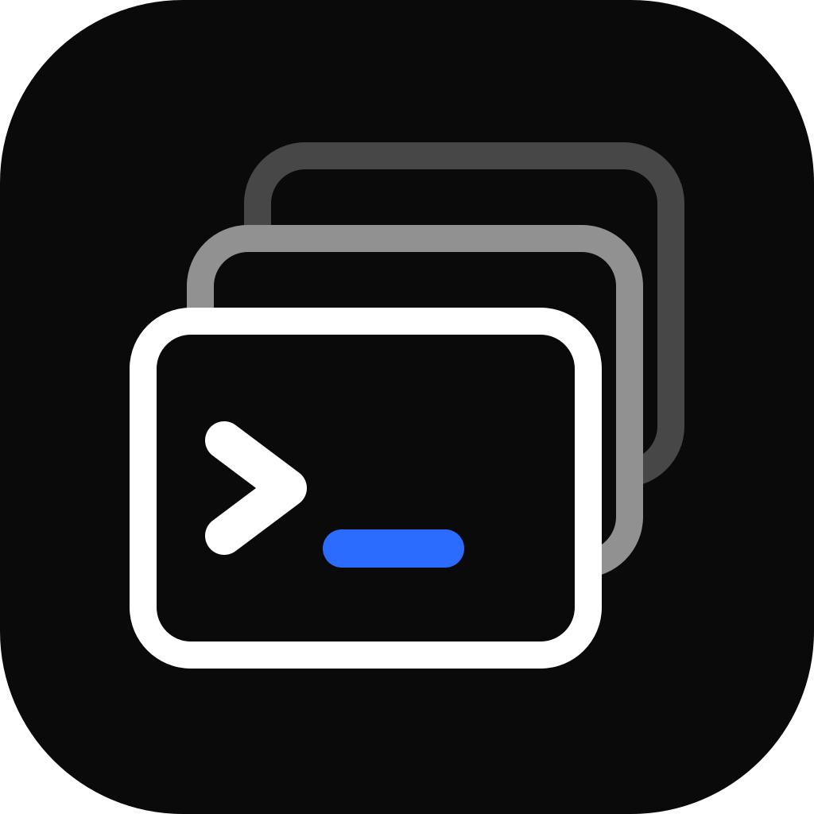
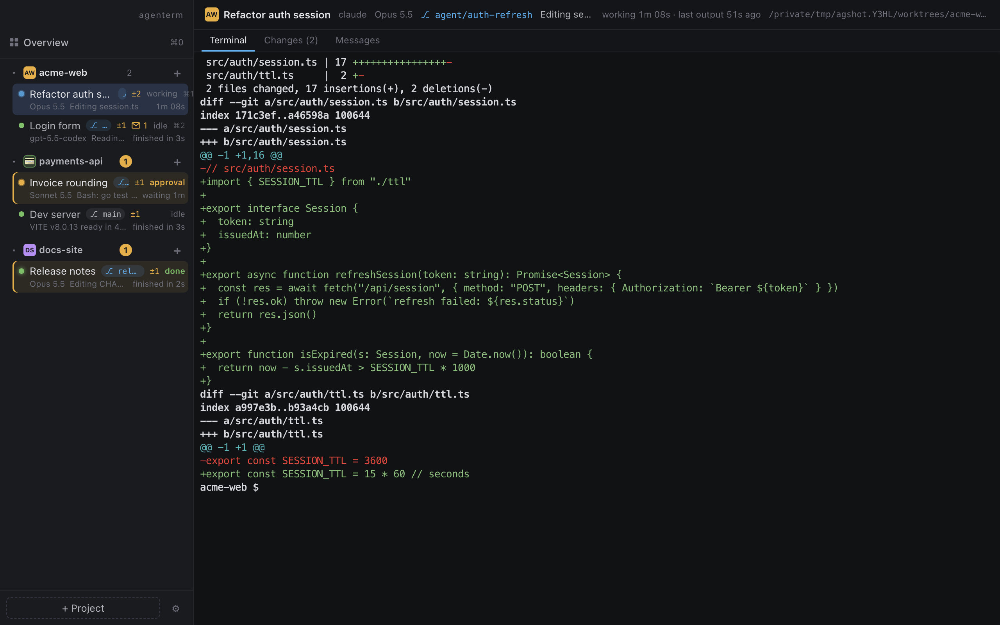

<p align="center">
  
</p>

# agenterm

[English](README.md) · **Español**

Workspace de escritorio para agentes de código, organizado por proyecto. Las pestañas de una
terminal no se pueden agrupar por proyecto, y cuando lanzas varios agentes (Claude Code, codex,
opencode, Gemini, Cursor…) sobre el mismo repo es difícil saber cuál está trabajando, cuál terminó
y cuál está esperando tu aprobación. agenterm agrupa las sesiones por proyecto, mantiene los agentes
vivos aunque cierres la app y te avisa cuando alguno te necesita.

<p align="center">
  
</p>

## Funciones

- **Proyectos y sesiones** en una barra lateral: cada proyecto es una carpeta y cada sesión una
  terminal (xterm.js) con un agente o una shell. Doble clic en una sesión para ponerle nombre.
- **Paneles divididos**: varias sesiones lado a lado o apiladas (⌘D / ⌘⇧D), con divisores que se
  arrastran; la disposición se guarda por proyecto.
- **Comodidades de terminal**: búsqueda en el scrollback (⌘F), ⌘-clic para abrir URLs, temas integrados (agenterm,
  Solarized, Dracula, Gruvbox, Nord), fuente, tamaño, interlineado y cursor, y la app en claro u
  oscuro (o siguiendo a macOS).
- **Cualquier CLI de agente**: catálogo integrado (Claude Code, codex, opencode, Gemini, Cursor,
  Copilot, aider, Amp, goose, Qwen, Crush, Kiro, shell) con detección automática de los instalados,
  más perfiles propios y variantes en `profiles.yaml`.
- **Las sesiones sobreviven a la app**: un daemon es dueño de las PTYs; cierras la ventana, la
  reabres y todo sigue ahí con su scrollback. La CLI y la app comparten el mismo daemon. Si el
  propio daemon se reinicia, las sesiones vuelven suspendidas con su scrollback y se reanudan con
  un clic (Claude Code y codex continúan la misma conversación).
- **Detección de atención**: aprobaciones, preguntas, turnos terminados y errores (hooks del agente
  o señales de terminal), con notificaciones nativas de macOS, badge del Dock y marcas en la sidebar.
- **Actividad en vivo**: qué está haciendo cada agente ("Editando main.go"), cronómetro del turno,
  aviso de «¿trabado?», barras de progreso (OSC 9;4) y una vista general en rejilla (⌘0).
- **Worktrees de git por sesión**: cada agente puede trabajar en su propia rama y carpeta; la
  pestaña **Cambios** muestra el diff y permite hacer merge a la base o eliminar el worktree de forma
  segura.
- **Ajustes en la app**: activar, ordenar y editar agentes, y configurar el idioma, la apariencia,
  las notificaciones y git.
- **Actualizaciones integradas** (Sparkle): una comprobación diaria en segundo plano, **Buscar
  actualizaciones…** en el menú de la app y una sección *Actualizaciones* en *Ajustes → General*;
  las instalaciones con Homebrew se dejan a `brew`.
- **En inglés y español**: la app sigue los idiomas preferidos de macOS (con inglés como respaldo)
  o el idioma que elijas en *Ajustes → General*.

## Instalación

Proyecto en etapa temprana (0.x): espera asperezas. La app necesita **macOS 13 (Ventura) o
posterior**; es un build universal (Apple Silicon e Intel), aunque se prueba sobre todo en Apple
Silicon.

### Homebrew

```sh
brew install --cask elionaz/tap/agenterm
```

Instala `agenterm.app` en `/Applications` y pone la CLI `agenterm` en tu `PATH` (la CLI viene dentro
de la app, en `agenterm.app/Contents/Helpers/agenterm`). `brew upgrade --cask agenterm` actualiza
ambas; `brew uninstall --zap --cask agenterm` borra además `~/.agenterm` y `~/.config/agenterm`.

### Descarga

Cada [release](https://github.com/elionaz/agenterm/releases) trae:

- `agenterm-<versión>-macos-universal.dmg` / `.zip`: la app (abre el dmg y arrástrala a
  Aplicaciones, o descomprime el zip);
- `agenterm-<versión>-darwin-universal.tar.gz`: solo la CLI para macOS;
- `agenterm-<versión>-linux-{amd64,arm64}.tar.gz`: la CLI y el daemon para Linux (experimental, sin
  notificaciones ni app);
- `checksums.txt`: el SHA-256 de cada archivo (`shasum -a 256 -c checksums.txt`).

Las releases van firmadas con un Developer ID y notarizadas por Apple. Si las notas de una release
dicen que es un **build sin firmar**, macOS se negará a abrirla; después de moverla a
`/Applications`, ejecuta `xattr -dr com.apple.quarantine /Applications/agenterm.app`.

Los cambios de cada versión están en [CHANGELOG.md](CHANGELOG.md) (solo en inglés).

### Compilar desde el código fuente

Requisitos:

- **macOS** (la app y las notificaciones son exclusivas de macOS).
- **Go 1.27.4+** (ver `go.mod`).
- **Node 24+** y npm (para el frontend; es la versión que usa el CI).
- **CLI de Wails v2**: `go install github.com/wailsapp/wails/v2/cmd/wails@v2.17.1` (`wails doctor`
  debe pasar).

```sh
git clone https://github.com/elionaz/agenterm.git
cd agenterm

# App de escritorio (incluye el daemon)
cd app && wails build          # -> app/build/bin/agenterm.app
open build/bin/agenterm.app    # o cópiala a /Applications

# CLI (opcional)
cd .. && go build -o agenterm ./cmd/agenterm
```

La primera vez que abras la app, macOS pregunta si permites notificaciones. Si lo rechazaste:
*Ajustes del Sistema → Notificaciones → agenterm* → "Permitir notificaciones". Sin ese permiso (o
desde un daemon fuera del `.app`) las notificaciones no se muestran, salvo que actives la
alternativa con AppleScript (`notify.fallback: osascript`; entonces aparecen como *Editor de
Scripts*). La CLI incluida en la app (la que Homebrew pone en tu `PATH`) arranca el daemon como la
app, así que también tiene notificaciones nativas.

## Actualizar

- **Homebrew**: `brew upgrade --cask agenterm`. La app detecta que la instaló Homebrew y desactiva
  su propio actualizador (lo indican los Ajustes y **Buscar actualizaciones…**), así brew sigue a
  cargo y `brew outdated` sigue funcionando. Aun así comprueba una vez al día si hay una release
  más nueva y, si la hay, muestra un aviso con **Copiar comando** (copia `brew upgrade --cask
  agenterm`).
- **App descargada** (dmg/zip): agenterm busca una release nueva una vez al día y ofrece instalarla;
  **agenterm → Buscar actualizaciones…** lo comprueba al momento. Si encuentra una versión nueva
  mientras trabajas, un aviso te lo indica (**Actualizar**, o **Reiniciar para actualizar** cuando
  ya se descargó; **Más tarde** lo oculta para esa versión hasta que se descargue) y también
  aparece en *Ajustes → General → Actualizaciones*. Reiniciar para actualizar solo relanza la ventana: el daemon en
  segundo plano y tus sesiones siguen corriendo. En *Ajustes → General →
  Actualizaciones* puedes desactivar la comprobación diaria o dejar que las actualizaciones se
  descarguen e instalen solas (al salir). Antes de instalarse se verifican con una firma EdDSA y la firma
  de código Developer ID de la app (las releases que se ofrecen desde la app siempre van
  notarizadas).
- Los builds desde el código fuente (`wails build`) no incluyen el actualizador.

Las sesiones corren en un daemon en segundo plano que sobrevive a la app, así que justo después de
actualizar el daemon sigue siendo la versión anterior: la ventana muestra un aviso con **Reiniciar
ahora**, que reinicia el daemon (las sesiones en marcha se suspenden y se reanudan, diga lo que
diga `sessions.restore`; las que habías dejado suspendidas siguen así). También puedes hacerlo más tarde, o desde una terminal con
`agenterm stop --force`.

## Inicio rápido

**App.** Haz clic en **+ Proyecto** y elige una carpeta. Con el **+** junto al proyecto eliges un agente
y si corre en la misma carpeta o en un worktree nuevo; **⌘N** lanza el primer agente de la lista.
Cuando un agente te necesita verás un punto ámbar en la sidebar y una notificación.

**CLI.** Cualquier comando arranca el daemon si no está corriendo:

```sh
agenterm project add ~/Dev/miapp           # -> <projectId>  miapp  /Users/yo/Dev/miapp
agenterm profiles                          # agentes del catálogo, instalados o no
agenterm spawn miapp claude                # -> <sessionId>
agenterm spawn --worktree miapp codex      # -> <sessionId>  <rama>  <carpeta>
agenterm ls                                # estado, atención, actividad, rama…
agenterm attach <sessionId>                # Ctrl-\ para desacoplar; la sesión sigue viva
agenterm stop                              # se niega si quedan sesiones vivas (usa --force)
```

Referencia completa: [docs/es/cli.md](docs/es/cli.md).

## Cómo se detecta la atención

Todo se configura **solo para las sesiones que lanza agenterm**, con flags en la línea de comandos y
archivos generados en `~/.agenterm/hooks/`. Nunca se modifican tus configuraciones
(`~/.claude/settings.json`, `~/.codex/config.toml`…) ni la carpeta del proyecto.

| agente | mecanismo | qué detecta |
|---|---|---|
| Claude Code | hooks vía `claude --settings <archivo generado>` (se suman a los tuyos) | trabajando + actividad, aprobación, pregunta, terminó, error |
| codex | `codex -c notify=[…]` + notificaciones OSC 9 del TUI | terminó (`notify`); aprobaciones y preguntas (OSC 9) |
| los demás | señales de terminal: BEL, OSC 9, OSC 777, OSC 99 y `attention_patterns` | esperando tu respuesta |

Detalles (estados, *ack*, «¿trabado?», progreso, notificaciones con la app cerrada):
[docs/es/attention-and-activity.md](docs/es/attention-and-activity.md).

## Configuración

| | por defecto | con `AGENTERM_HOME=/x` |
|---|---|---|
| socket, pid, log del daemon | `~/.agenterm/{d.sock,d.pid,daemon.log}` | `/x/…` |
| `profiles.yaml`, `settings.yaml`, `projects.json` | `~/.config/agenterm/` | `/x/` |
| hooks generados, worktrees, `worktrees.json` | `~/.agenterm/{hooks,worktrees,worktrees.json}` | `/x/…` |

`profiles.yaml` y `settings.yaml` son opcionales y la app los edita desde **Ajustes** (⌘,).

**`profiles.yaml`** se superpone al catálogo por `id`: cambias solo los campos que pongas, creas
variantes con `extends`, ocultas agentes con `enabled: false` y el orden de la lista es el del menú
(el primero es el de ⌘N):

```yaml
- id: claude-yolo                 # variante: hereda todo de claude
  name: Claude (sin permisos)
  extends: claude
  args: ["--dangerously-skip-permissions"]
- id: claude
  env: {CLAUDE_CODE_USE_BEDROCK: "1"}
- id: gemini
  enabled: false
- id: mio                         # perfil propio
  cmd: $HOME/bin/mi-agente
  attention_patterns: ['\(y/n\)']
```

**`settings.yaml`** (valores por defecto):

```yaml
ui:
  language: auto         # auto (idiomas preferidos de macOS; si no, inglés) | en | es
  appearance: system     # colores de la app: system (sigue a macOS) | dark | light
terminal:
  font_family: '"SF Mono", Menlo, Monaco, monospace'
  font_size: 13          # 8-32 (también ⌘= / ⌘- / ⌘⌥0)
  line_height: 1.15      # 1.0-2.0
  cursor_style: block    # block | bar | underline
  theme: agenterm-dark   # agenterm-dark | agenterm-light | solarized-dark | solarized-light |
                         # dracula | gruvbox-dark | nord
notify:
  enabled: true          # notificaciones (app y daemon)
  sound: true            # sonido en aprobación/pregunta
  notify_on_done: true   # avisar también cuando un agente termina
  notify_on_stall: true  # aviso discreto si un turno parece trabado
  fallback: none         # none | osascript: si no se pueden usar las nativas
                         # (osascript aparece como Editor de Scripts)
activity:
  stall_seconds: 180     # segundos sin salida ni eventos para «¿trabado?»; 0 lo desactiva
git:
  editor: ""             # para «Abrir en editor»; vacío: code si existe, si no Finder
  worktree_dir: ""       # dónde crear worktrees; vacío: ~/.agenterm/worktrees
  default_mode: same     # same | worktree
```

Todas las reglas y el catálogo completo: [docs/es/configuration.md](docs/es/configuration.md). Worktrees
y diff: [docs/es/worktrees.md](docs/es/worktrees.md).

## Atajos de teclado

| atajo | acción |
|---|---|
| ⌘N | nueva sesión en el proyecto actual con el primer agente activado e instalado |
| ⌘1 … ⌘9 | seleccionar la sesión n del proyecto actual |
| ⌘0 | abrir/cerrar la vista general |
| ⌘, | abrir Ajustes |
| ⌘D / ⌘⇧D | dividir el panel enfocado a la derecha / abajo con una sesión nueva del mismo agente y modo |
| ⌘W | cerrar el panel enfocado (la sesión sigue en marcha; se termina con × en la barra lateral) |
| ⌘[ / ⌘] | enfocar el panel anterior / siguiente |
| ⌘⌥← ↑ → ↓ | enfocar el panel en esa dirección |
| ⌘F | buscar en la terminal enfocada; Enter / ⇧Enter o ⌘G / ⌘⇧G para siguiente / anterior |
| ⌘= / ⌘- / ⌘⌥0 | fuente de la terminal más grande / más pequeña / por defecto (se guarda en `terminal.font_size`) |
| ⌘C / ⌘V | copiar la selección / pegar en la terminal |
| ⌘-clic | abrir en el navegador la URL bajo el puntero (URLs en texto y enlaces OSC 8; solo http y https) |
| Esc | cerrar la búsqueda, la vista general, Ajustes o la vista de un worktree huérfano |
| `Ctrl-\` | desacoplarse de `agenterm attach` (CLI) |

## Documentación

- [docs/es/cli.md](docs/es/cli.md): todos los comandos y flags de la CLI.
- [docs/es/configuration.md](docs/es/configuration.md): rutas, `profiles.yaml`, catálogo de agentes y
  `settings.yaml`.
- [docs/es/attention-and-activity.md](docs/es/attention-and-activity.md): hooks, señales de terminal,
  notificaciones, actividad, «¿trabado?» y progreso.
- [docs/es/worktrees.md](docs/es/worktrees.md): worktrees por sesión, diff, merge y borrado.
- [docs/es/architecture.md](docs/es/architecture.md): daemon, app y CLI, protocolo, eventos y
  persistencia.
- [docs/es/development.md](docs/es/development.md): desarrollo, tests, publicación de releases,
  icono y limitaciones conocidas.
- [CHANGELOG.md](CHANGELOG.md): los cambios de cada versión (en inglés).

Si cambias comandos, flags, rutas o `settings.yaml`, actualiza el README y el documento
correspondiente en `docs/`, en inglés (`README.md`, `docs/`) y en español (`README.es.md`,
`docs/es/`).

## Contribuir

Las contribuciones son bienvenidas vía pull request: lee [CONTRIBUTING.es.md](CONTRIBUTING.es.md). Para
reportar vulnerabilidades, sigue [SECURITY.es.md](SECURITY.es.md).

Licencia: [MIT](LICENSE).
