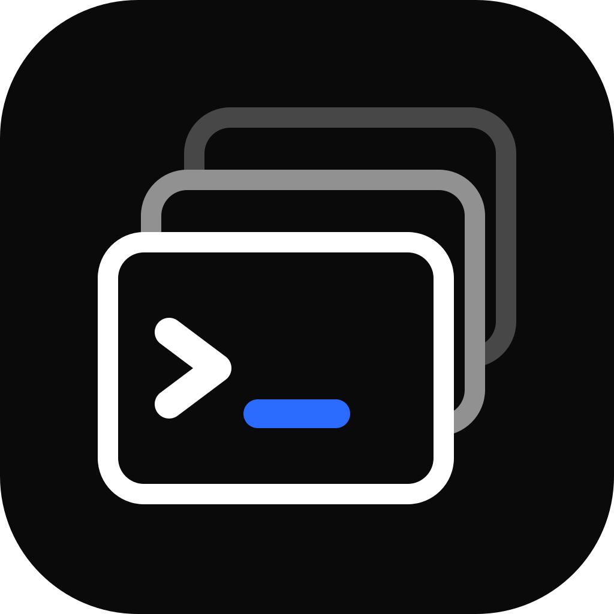
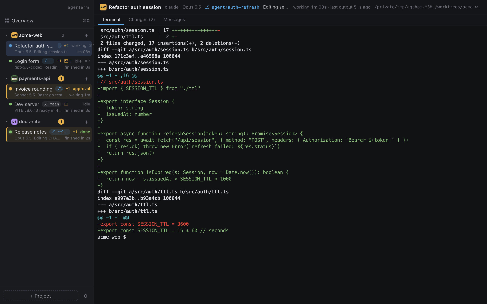
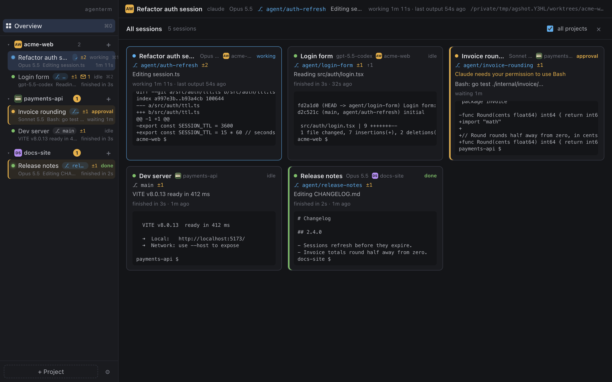
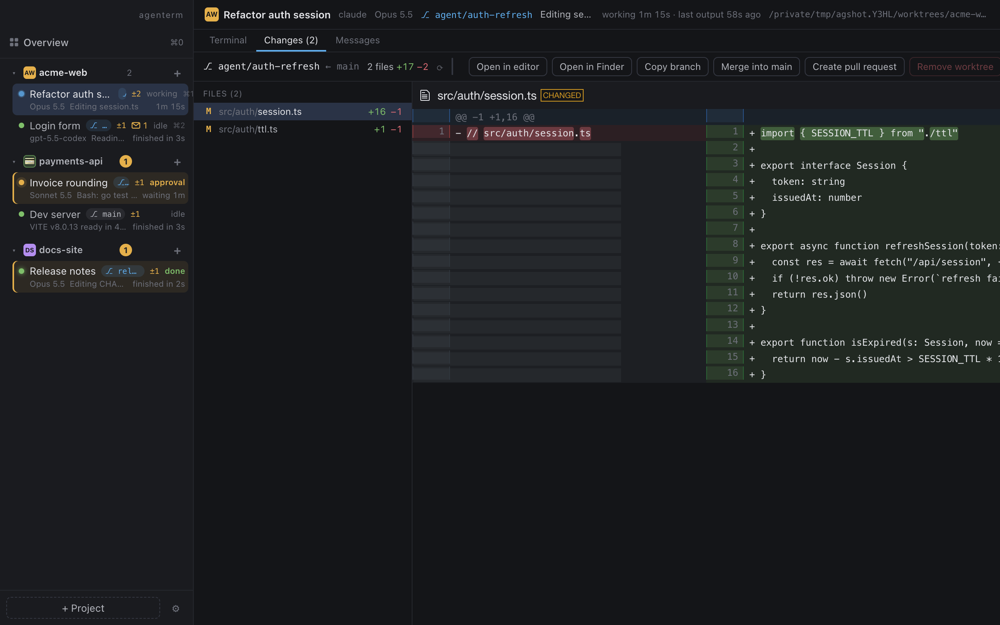
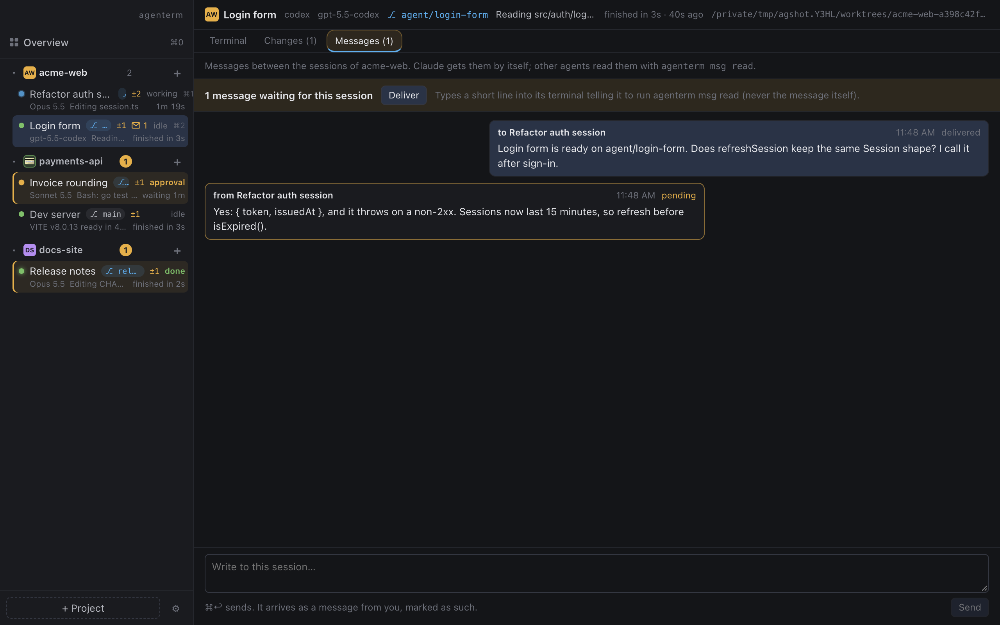

<p align="center">
  
</p>

# agenterm

**English** · [Español](README.es.md)

A desktop workspace for coding agents, organized by project. Terminal tabs can't be grouped by
project, and once you run several agents (Claude Code, codex, opencode, Gemini, Cursor…) on the same
repo it's hard to tell which one is working, which one is done and which one is waiting for your
approval. agenterm groups sessions by project, keeps agents alive even after you close the app and
tells you when one of them needs you.

<p align="center">
  
</p>

## Features

- **Projects and sessions** in a sidebar: each project is a folder and each session is a terminal
  (xterm.js) running an agent or a shell, with its model (*Opus 5.5*) and its branch. Double-click
  a session to give it a name; drag projects
  and sessions to reorder them. Each project has a badge with its initials and a color; click it (or
  right-click the project) to rename the project, pick a color or put an emoji instead. Drop files (e.g. screenshots) on a terminal to type their paths;
  Claude Code attaches dropped images.
- **Split panes**: show several sessions side by side or stacked (⌘D / ⌘⇧D), with draggable
  dividers; the layout is kept per project.
- **Terminal comforts**: search the scrollback (⌘F), ⌘-click to open URLs, nine built-in themes named after
  albums (*Turn On the Bright Lights*, *Room on Fire*, *Is This It*, *Funeral*, *Silent Alarm*, *Z*,
  *It Still Moves*, *Alphabetical* and *Hot Fuss*), font, size, line height and cursor, plus a light
  or dark app (or follow macOS).
- **Any agent CLI**: a built-in catalog (Claude Code, codex, opencode, Gemini, Cursor, Copilot,
  aider, Amp, goose, Qwen, Crush, Kiro, shell) that detects which ones are installed, plus your own
  profiles and variants in `profiles.yaml`.
- **Sessions outlive the app**: a daemon owns the PTYs; close the window, reopen it and everything
  is still there, scrollback included. The CLI and the app share the same daemon. If the daemon
  itself restarts, sessions come back suspended with their scrollback and resume with one click
  (Claude Code and codex continue the same conversation).
- **Attention detection**: approvals, questions, finished turns and errors (agent hooks or terminal
  signals), with native macOS notifications, a Dock badge and sidebar markers.
- **Live activity**: what each agent is doing ("Editing main.go"), a turn timer, a "stalled?"
  warning, progress bars (OSC 9;4) and an **Overview** of every session (⌘0).
- **Per-session git worktrees**: new agents start on their own branch and folder by default, so
  agents working in parallel never share changes; the **Changes** tab shows the diff and lets you
  merge into the base or safely remove the worktree.
- **Pull requests on GitHub and GitLab** from the **Changes** tab, for worktrees and for the
  branch your main folder is on: state, checks and review, the comments (line comments jump to the
  file), merging on the host, and opening a new one with a suggested title and description. It
  uses your own `gh` / `glab` login; agenterm stores no tokens.
- **Messages between sessions**: the agents of a project can write to each other
  (`agenterm msg send`, `agenterm wait`); Claude Code gets its messages by itself, other agents
  read them with `agenterm msg read` or get a nudge from the **Messages** tab (optionally automatic
  for idle Claude sessions). Messages never leave
  their project and the daemon decides who sent each one.
- **In-app settings**: enable, reorder and edit agents, and configure the language, appearance,
  notifications and git.
- **In-app updates** (Sparkle): a daily background check, **Check for Updates…** in the app menu
  and an *Updates* section in **Settings → General**, Homebrew installs included.
- **English and Spanish**: the app follows your macOS preferred languages (falling back to English)
  or the language you pick in **Settings → General**.

## Screenshots

| | | |
|---|---|---|
|  |  |  |
| **Overview** (⌘0): every session at a glance | **Changes**: the diff, merge or pull request | **Messages** between the sessions of a project |

## Install

Early-stage project (0.x): expect rough edges. The app needs **macOS 13 (Ventura) or later**; it's a
universal build (Apple Silicon and Intel) but is mostly tested on Apple Silicon.

### Homebrew

```sh
brew install --cask elionaz/tap/agenterm
```

This installs `agenterm.app` in `/Applications` and puts the `agenterm` CLI on your `PATH` (the CLI
ships inside the app, at `agenterm.app/Contents/Helpers/agenterm`). The app keeps both up to date
([Updating](#updating)); `brew uninstall --zap --cask agenterm` also deletes `~/.agenterm` and
`~/.config/agenterm`.

### Download

Each [release](https://github.com/elionaz/agenterm/releases) has:

- `agenterm-<version>-macos-universal.dmg` / `.zip`: the app (open the dmg and drag it to
  Applications, or unzip it);
- `agenterm-<version>-darwin-universal.tar.gz`: just the CLI for macOS;
- `agenterm-<version>-linux-{amd64,arm64}.tar.gz`: the CLI and daemon for Linux (experimental,
  without notifications or the app);
- `checksums.txt`: SHA-256 of every file (`shasum -a 256 -c checksums.txt`).

Releases are signed with a Developer ID and notarized by Apple. If a release's notes say it's an
**unsigned build**, macOS will refuse to open it; after moving it to `/Applications`, run
`xattr -dr com.apple.quarantine /Applications/agenterm.app`.

### Build from source

Requirements:

- **macOS** (the app and notifications are macOS-only).
- **Go 1.27.4+** (see `go.mod`).
- **Node 24+** and npm (for the frontend; it's the version CI uses).
- **Wails v2 CLI**: `go install github.com/wailsapp/wails/v2/cmd/wails@v2.17.1` (`wails doctor`
  must pass).

```sh
git clone https://github.com/elionaz/agenterm.git
cd agenterm

# Desktop app (includes the daemon)
cd app && wails build          # -> app/build/bin/agenterm.app
open build/bin/agenterm.app    # or copy it to /Applications

# CLI (optional)
cd .. && go build -o agenterm ./cmd/agenterm
```

The first time you open the app, macOS asks whether to allow notifications. If you declined:
*System Settings → Notifications → agenterm* → "Allow notifications". Without that permission (or
from a daemon outside the `.app`) notifications are not shown, unless you enable the AppleScript
fallback (`notify.fallback: osascript`; they then show as *Script Editor*). The CLI bundled in the
app (what Homebrew puts on your `PATH`) starts the daemon as the app, so it gets native
notifications too.

## Updating

- **Homebrew**: the app updates itself, like a downloaded one (below). A plain `brew upgrade`
  leaves it alone, as with any cask that updates itself; `brew upgrade --cask agenterm` (or
  `--greedy`) still upgrades it. Installs from before 0.4.2 need one last
  `brew upgrade --cask agenterm` to get there.
- **Downloaded app** (dmg/zip): agenterm checks for a new release once a day and offers to install
  it; **agenterm → Check for Updates…** checks right away. When a new version is found while you're
  working, a banner says so (**Update**, or **Restart to update** once it's downloaded; **Later**
  hides it for that version until it is downloaded) and **Settings → General → Updates** shows it
  too. Restarting to update only relaunches the window: the background daemon and your sessions
  keep running. In
  **Settings → General → Updates** you can turn the daily check off or let updates download and
  install by themselves (on quit). Updates are checked against an EdDSA signature and the app's
  Developer ID code signature before they're installed (releases offered in-app are always
  notarized).
- Builds from source (`wails build`) don't include the updater.

Sessions run in a background daemon that survives the app, so right after an update the daemon is
still the old version. The app restarts it on its own when no agent is in the middle of a turn
(the sessions running then are suspended and resumed, whatever `sessions.restore` says; sessions
you had left suspended stay so). If an agent is working, it shows a banner with **Restart now**
instead, so you can do it when it suits you, or later from a terminal with `agenterm stop --force`.

## Uninstall

First stop the daemon: quit the app, then `agenterm stop` (it refuses while sessions are running;
`agenterm stop --force` kills them). Then:

- **Homebrew**: `brew uninstall --cask agenterm` removes the app and the CLI and keeps your data.
  `brew uninstall --zap --cask agenterm` also deletes it: `~/.agenterm`, `~/.config/agenterm` and
  agenterm's files in `~/Library` (caches, preferences, WebKit data, saved window state).
- **By hand**: delete `/Applications/agenterm.app`, the CLI link if you made one
  (`/usr/local/bin/agenterm`), and, to delete your data too, `~/.agenterm` (daemon state, scrollback
  and agenterm's worktrees), `~/.config/agenterm` (settings, profiles, projects) and
  `~/Library/{Caches,WebKit}/com.elionaz.agenterm`,
  `~/Library/Preferences/com.elionaz.agenterm.plist` and
  `~/Library/Saved Application State/com.elionaz.agenterm.savedState`.

**Before deleting `~/.agenterm`**, check `~/.agenterm/worktrees` (or your `git.worktree_dir`): it holds the
worktrees agenterm created, and any uncommitted work in them is lost with it (`--zap` included). Their branches stay in
your repositories; `git worktree prune` cleans up the references afterwards.

Nothing else needs undoing: agenterm doesn't change your agents' configuration (hooks are added to
each session it starts, not installed) and doesn't touch your project folders.

## Quick start

**App.** The first time, a welcome screen shows which agent CLIs were found, lets you allow
notifications and shows how to put the `agenterm` command on your `PATH`. Click **+ Add your first
project** (or the sidebar's **+ Project** button) and pick a folder. With the **+** next to a
project you choose an agent and whether it runs in a new worktree (the default) or in the project
folder; **⌘N**
launches the first agent in the list. When an agent needs you, you'll see an amber dot in the sidebar
and get a notification.

**Several agents in one project.** Each new agent gets its own **worktree** by default (its own
branch and folder), so their work stays apart; a plain **Shell** starts in the project folder.
Sessions that do share the project folder (**Same folder** in the **+** menu) share its branch and
its changes: what one agent edits or commits, the others see. You bring the work back with **Merge
into the base** or **Create pull request** in the Changes tab. More in
[docs/worktrees.md](docs/worktrees.md#several-agents-in-one-project).

**CLI.** Any command starts the daemon if it isn't running:

```sh
agenterm project add ~/Dev/myapp           # -> <projectId>  myapp  /Users/me/Dev/myapp
agenterm profiles                          # catalog agents, installed or not
agenterm spawn myapp claude                # -> <sessionId>
agenterm spawn --worktree myapp codex      # -> <sessionId>  <branch>  <folder>
agenterm ls                                # state, attention, activity, branch…
agenterm attach <sessionId>                # Ctrl-\ to detach; the session keeps running
agenterm stop                              # refuses while sessions are live (use --force)
```

Full reference: [docs/cli.md](docs/cli.md).

## How attention is detected

Everything is configured **only for the sessions agenterm launches**, through command-line flags and
files generated in `~/.agenterm/hooks/`. Your own configuration (`~/.claude/settings.json`,
`~/.codex/config.toml`…) and the project folder are never modified.

| agent | mechanism | what it detects |
|---|---|---|
| Claude Code | hooks via `claude --settings <generated file>` (added on top of yours) | working + activity, approval, question, done, error |
| codex | `codex -c notify=[…]` + OSC 9 notifications from the TUI | done (`notify`); approvals and questions (OSC 9) |
| everything else | terminal signals: BEL, OSC 9, OSC 777, OSC 99 and `attention_patterns` | waiting for your reply |

Details (states, *ack*, "stalled?", progress, notifications while the app is closed):
[docs/attention-and-activity.md](docs/attention-and-activity.md).

## Configuration

| | default | with `AGENTERM_HOME=/x` |
|---|---|---|
| daemon socket, pid, log | `~/.agenterm/{d.sock,d.pid,daemon.log}` | `/x/…` |
| `profiles.yaml`, `settings.yaml`, `projects.json` | `~/.config/agenterm/` | `/x/` |
| generated hooks, worktrees, `worktrees.json` | `~/.agenterm/{hooks,worktrees,worktrees.json}` | `/x/…` |

`profiles.yaml` and `settings.yaml` are optional, and the app edits them from **Settings** (⌘,).

**`profiles.yaml`** is layered over the catalog by `id`: you change only the fields you set, create
variants with `extends`, hide agents with `enabled: false`, and the list order is the menu order (the
first one is what ⌘N launches):

```yaml
version: 1
profiles:
  - id: claude-yolo                 # variant: inherits everything from claude
    name: Claude (no permissions)
    extends: claude
    args: ["--dangerously-skip-permissions"]
  - id: claude
    env: {CLAUDE_CODE_USE_BEDROCK: "1"}
  - id: gemini
    enabled: false
  - id: mine                        # your own profile
    cmd: $HOME/bin/my-agent
    attention_patterns: ['\(y/n\)']
```

**`settings.yaml`** (defaults):

```yaml
version: 1
ui:
  language: auto         # auto (macOS preferred languages, else English) | en | es
  appearance: system     # the app's colors: system (follow macOS) | dark | light
terminal:
  font_family: '"SF Mono", Menlo, Monaco, monospace'
  font_size: 13          # 8-32 (⌘= / ⌘- / ⌘⌥0 change it too)
  line_height: 1.15      # 1.0-2.0
  cursor_style: block    # block | bar | underline
  theme: bright-lights   # bright-lights | room-on-fire | is-this-it | funeral | silent-alarm | z |
                         # it-still-moves | alphabetical | hot-fuss
notify:
  enabled: true          # notifications (app and daemon)
  sound: true            # sound on approval/question
  notify_on_done: true   # also notify when an agent finishes
  notify_on_stall: true  # low-key notice when a turn looks stalled
  fallback: none         # none | osascript: when native notifications can't be used
                         # (osascript shows as Script Editor)
activity:
  stall_seconds: 180     # seconds without output or events before "stalled?"; 0 disables it
git:
  editor: ""             # for "Open in editor"; empty: code if available, else Finder
  worktree_dir: ""       # where to create worktrees; empty: ~/.agenterm/worktrees
  default_mode: worktree # worktree | same
```

All the rules and the full catalog: [docs/configuration.md](docs/configuration.md). Worktrees and
diffs: [docs/worktrees.md](docs/worktrees.md).

## Keyboard shortcuts

| shortcut | action |
|---|---|
| ⌘N | new session in the current project with the first enabled, installed agent |
| ⌘1 … ⌘9 | select session n of the current project |
| ⌘⇧↑ / ⌘⇧↓ | move the selected session up / down in its project (or drag it in the sidebar) |
| ⌘0 | open/close the overview |
| ⌘, | open Settings |
| ⌘D / ⌘⇧D | split the focused pane right / down with a new session of the same agent and mode |
| ⌘W | close the focused pane (the session keeps running; stop it with × in the sidebar) |
| ⌘[ / ⌘] | focus the previous / next pane |
| ⌘⌥← ↑ → ↓ | focus the pane in that direction |
| ⌘F | search the focused terminal; Enter / ⇧Enter or ⌘G / ⌘⇧G for next / previous |
| ⌘= / ⌘- / ⌘⌥0 | bigger / smaller / default terminal font (saved to `terminal.font_size`) |
| ⌘C / ⌘V | copy the selection / paste into the terminal |
| ⌘-click | open the URL under the pointer in the browser (plain-text URLs and OSC 8 links; http and https only) |
| ⇧Enter | new line in the prompt instead of sending it (Claude Code, Codex…); sends a line feed (Ctrl-J) |
| Esc | close the search bar, the overview, Settings or an orphaned worktree's view |
| `Ctrl-\` | detach from `agenterm attach` (CLI) |

## Documentation

- [docs/cli.md](docs/cli.md): every CLI command and flag.
- [docs/configuration.md](docs/configuration.md): paths, `profiles.yaml`, the agent catalog,
  `settings.yaml` and the app language.
- [docs/attention-and-activity.md](docs/attention-and-activity.md): hooks, terminal signals,
  notifications, activity, "stalled?" and progress.
- [docs/worktrees.md](docs/worktrees.md): per-session worktrees, diff, merge and removal.
- [docs/messages.md](docs/messages.md): messages between the sessions of a project.
- [docs/architecture.md](docs/architecture.md): daemon, app and CLI, protocol, events and
  persistence.
- [docs/development.md](docs/development.md): development, tests, releasing, the icon and known
  limitations.
- [docs/compatibility.md](docs/compatibility.md): what stays stable between versions, file format
  and protocol versions, and going back to an older version.
- [CHANGELOG.md](CHANGELOG.md): what changed in each release.

If you change commands, flags, paths or `settings.yaml`, update the README and the matching document
in `docs/`, in English (`README.md`, `docs/`) and Spanish (`README.es.md`, `docs/es/`).

## Contributing

Contributions are welcome via pull request: read [CONTRIBUTING.md](CONTRIBUTING.md). To report a
vulnerability, follow [SECURITY.md](SECURITY.md).

License: [MIT](LICENSE).
